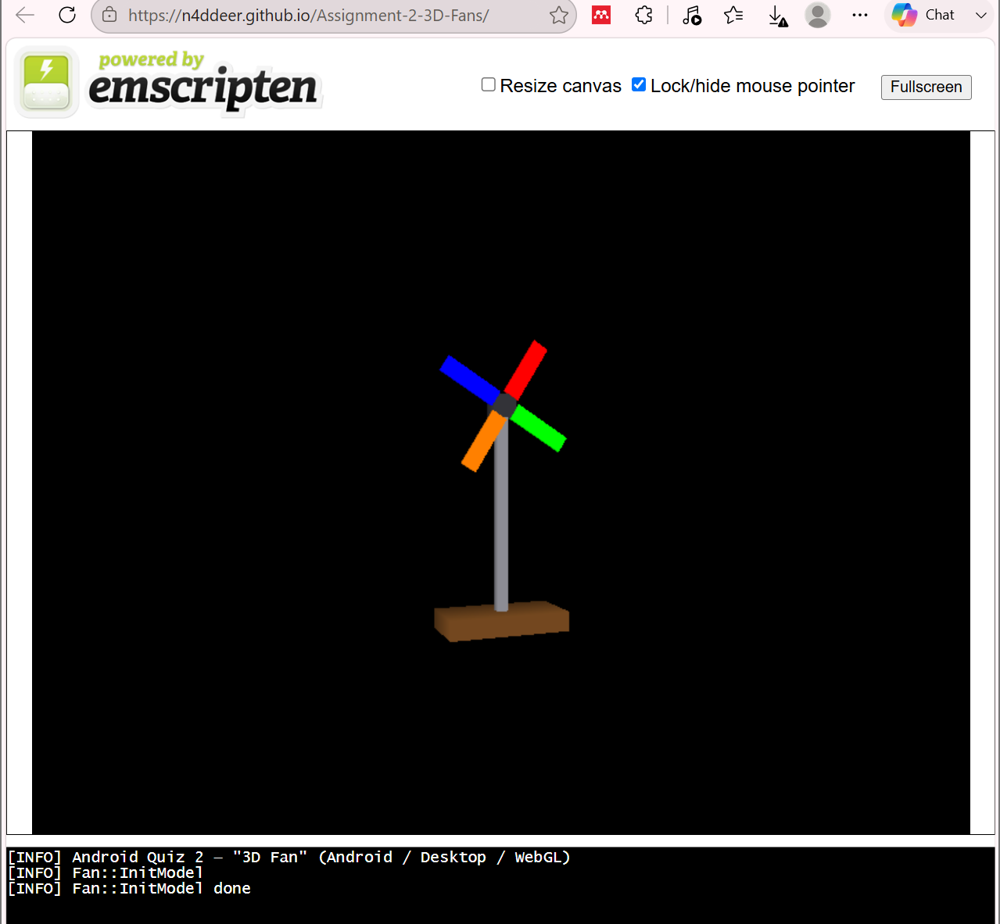
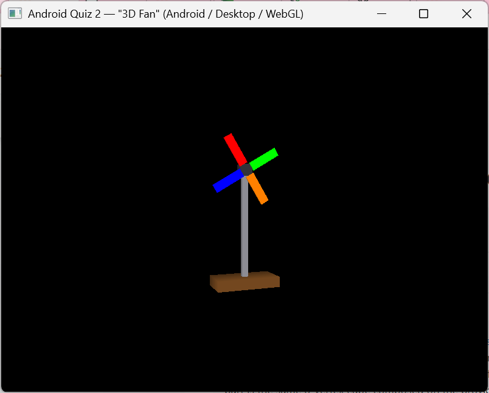
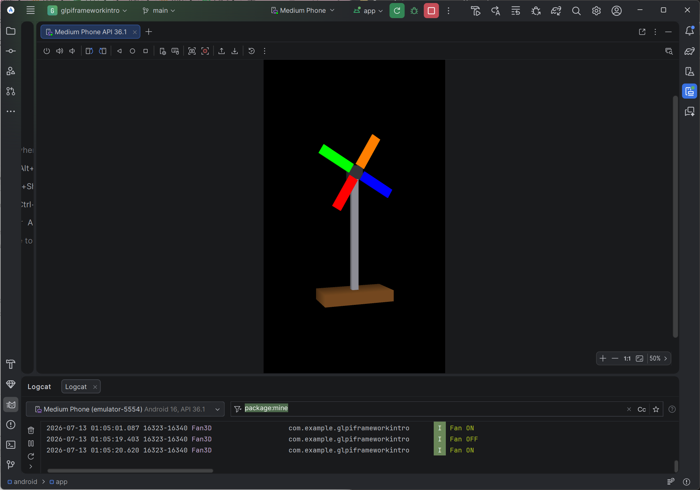

# 3D Fan: one C++ codebase on Desktop, Android and the Web

**Live demo:** https://n4ddeer.github.io/Assignment-2-3D-Fans/
(click to turn the fan on and off, click and drag to spin it faster)



A small table fan (base, pole, hub and four blades) rendered with OpenGL, built
from a single cube drawn seven times with different model matrices on a
push/pop transform stack. The same shared C++ code runs on Desktop (GLFW),
Android (GLSurfaceView + JNI) and the browser (Emscripten / WebGL2).

Made for CSD 2101 Computer Graphics at SIT-DigiPen (Assignment 2). The matrix
stack in `Transform.h/.cpp` was provided and left unmodified. The fan model and
the tap and swipe gestures are my work.

| Desktop | Android | Web |
|---|---|---|
|  |  |  |

Tapping the screen (or clicking with the mouse) toggles the fan on and off, and
dragging speeds the blades up temporarily based on how fast you swipe.

## Project layout

```
CMakeLists.txt              Desktop (Windows) entry point, builds Scene/ with GLFW + GLEW + GLM
script_build_and_run.bat    Desktop convenience wrapper around the CMake build above
build_web.bat / .sh         Web entry point, compiles Scene/ to WebAssembly/WebGL2 via Emscripten
cmake/ImportDependencies.cmake
Scene/                      Shared by all three platforms
  Platform.h, Model.h, Renderer.h/.cpp, ShaderHelper.h
  Transform.h/.cpp          Provided matrix stack, not modified
  Fan.h/.cpp                My implementation for this assignment
  main.cpp                  Desktop + Web entry point (Android uses NativeTemplate.cpp instead)
android/                    Android Studio / Gradle project
```

`build_desktop/`, `web/`, and `external/` are all build output and are not part of
this submission (see `.gitignore`).

## Building and running

### Desktop (Windows)

Needs CMake 3.15+ and Visual Studio 2022 on `PATH`. GLFW, GLEW, and GLM are all
pulled in automatically the first time you configure, through CMake's
`FetchContent`, so nothing needs to be installed by hand.

```
script_build_and_run.bat
```

This wipes and reconfigures `build_desktop/`, builds it in Debug, and launches
`Fan3D.exe`. The first run can take a few minutes since it has to download the
dependencies. Click to toggle the fan, click and drag to speed it up, and press
ESC to quit.

Equivalent manual steps, if you'd rather run them yourself:

```
cmake -S . -B build_desktop -G "Visual Studio 17 2022" -A x64
cmake --build build_desktop --config Debug
build_desktop\Debug\Fan3D.exe
```

### Android

Open the `android/` folder in Android Studio (not the repo root), let Gradle
sync, then hit Run and pick an emulator or a physical device. First sync also
takes a while because it fetches GLM through the NDK's own CMake build.

Or from the command line:

```
cd android
gradlew.bat assembleDebug
```

Touch is wired through `GLSurfaceView.queueEvent()` in `MainActivity.java`, so
tap/down/move/release calls always happen on the GL thread. To watch the log
output while testing gestures, filter Logcat by tag `Fan3D`:

```
adb logcat -s Fan3D
```

### Web (Emscripten)

Needs the Emscripten SDK installed and activated in the current terminal
session (`emsdk_env.bat` / `emsdk_env.sh`, this only lasts for that terminal
window, so it has to be re-run if you open a new one).

```
build_web.bat
```

(or `./build_web.sh` on macOS/Linux). GLM gets cloned once into `external/glm`
the first time this runs, since the web build calls `emcc` directly instead of
going through CMake. This produces `web/index.html`, `index.js`, `index.wasm`,
and `index.data` (the preloaded shader assets). It has to be served over HTTP,
opening the file directly will fail because of browser WASM/fetch
restrictions:

```
cd web
python -m http.server 8080
```

Then open `http://localhost:8080/` in a browser. Click to toggle the fan,
click and drag to boost the spin speed.

The live deployed build (via the GitHub Actions workflow in
`.github/workflows/pages.yml`) is here:

https://n4ddeer.github.io/Assignment-2-3D-Fans/

## How it's put together

- **One cube, drawn seven times.** `Fan::InitModel()` uploads the 8 vertices
  and 36 indices for a single cube once (one VBO split into a positions
  sub-region and a per-corner shade sub-region via `glBufferSubData`, plus an
  IBO, all captured in one VAO), following the same pattern taught in the
  Attribute Layouts and Vertex Array Object tutorials. `Fan::Render()` then
  pushes/pops the Transform stack seven times (base, pole, hub, and four
  blades), each with its own scale/rotate/translate and its own colour
  uploaded through the `PARTCOLOR` uniform before the shared `glDrawElements`
  call.
- **Animation.** `spinAngle` advances by `kBaseSpeed` plus `dragBoost` every
  frame inside `Render()`, the same place the rotation update lives in the
  Drawing APIs and Vertex Array Object tutorial samples.
- **Gestures.** `Fan::TouchEventDown/Move/Release` track the distance moved
  since touch-down to tell a tap from a swipe (tap toggles `fanOn` and logs
  `Fan ON`/`Fan OFF`), and measure drag velocity with `std::chrono` to compute
  `dragBoost`, clamped to `kMaxBoost` and reset to 0 on release. These get
  called from `Renderer`, which just forwards to every `Model` in its list, so
  `main.cpp` (Desktop/Web mouse) and `MainActivity.java` (Android touch, via
  `queueEvent`) both funnel into the same three functions.
- `Scene/Model.h` is the interface every shape has to implement
  (`InitModel`, `Render`, `Resize`, and the three touch events). `Renderer`
  only ever talks to `Model*`, it never knows about `Fan` directly, that
  boundary lives in `Renderer.cpp`.
- `Scene/Transform.h/.cpp` were provided for this assignment and were left
  unmodified. It's a classic post-multiplying, parent-first matrix stack
  built on GLM, angles go in as radians.
